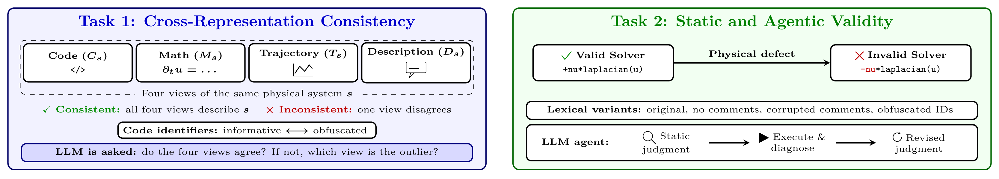

<div align="center">

# Solver to System: LLM Reasoning Across Representations and Execution in Scientific Simulation

**Eliza Berman\*, Rohan Subramanian\*, Shreya Jha, Lohit Jagarapu, Romain Lopez, Rajesh Ranganath**

New York University &nbsp;·&nbsp; \*Equal contribution

*[Sim2Science: ML with Imperfect Scientific Models](https://sim2science.com) Workshop at NeurIPS 2026*

[**Paper**](TODO-paper-link) &nbsp;|&nbsp; [**Cross-Representation Dataset**](https://huggingface.co/datasets/bermaneh/pde-llm-eval-cross-representation-dataset) &nbsp;|&nbsp; [**Code Validity Dataset**](https://huggingface.co/datasets/bermaneh/pde-llm-eval-code-perturbation-dataset) &nbsp;|&nbsp; [**Citation**](#citation)

</div>

<p align="center">
  
</p>

## Abstract

Simulators based on partial differential equations (PDEs) are widely used to model physical
systems, but generating and interpreting PDE solver code with large language models (LLMs)
remains challenging. Scientific simulation code is a useful testbed for LLM scientific
reasoning because (1) one system can be represented by code, equations, natural language,
and numerical trajectories and (2) code can execute successfully while implementing invalid
physics. We ask whether LLMs can recover the underlying physical system across
representations and under lexical perturbations, evaluating (1) cross-representation
consistency and (2) static and agentic detection of physical invalidities in code. We
introduce *Solver2System*, a dataset of PDE solvers with multiple representations,
controlled corruptions, and lexical perturbations. Across eight open-weight models, LLMs
systematically favor some representations when evidence conflicts, and lexical
perturbations to code alter interpretation of other unchanged representations. Execution
improves physical-validity judgments; weaker agents can judge correctly without identifying
causal defects in code, while stronger agents combine accurate static judgments with
targeted diagnostics. Together, these results show that verification accuracy can overstate
LLM scientific reliability and reasoning: LLMs can reach correct judgments with inconsistent
representation reconciliation or causal misdiagnosis.

## Dataset

Both datasets are built from 32 Python PDE solvers (8 each of Heat, Wave, Burgers and
Navier–Stokes). Each solver has a physically invalid counterpart that still runs.

| dataset | contents | rows | HuggingFace | CSV |
|---|---|---|---|---|
| Cross-Representation | each system as code, equation, natural-language description and numerical trajectory, with a valid and a corrupted version of each | 32 | [link](https://huggingface.co/datasets/bermaneh/pde-llm-eval-cross-representation-dataset) | [`dataset_cross_representation.csv`](dataset_release/dataset_cross_representation.csv) |
| Code Validity | valid/invalid solver pairs under 4 lexical conditions: original code, no comments, corrupted comments, obfuscated identifiers | 256 | [link](https://huggingface.co/datasets/bermaneh/pde-llm-eval-code-perturbation-dataset) | [`dataset_code_perturbation.csv`](dataset_release/dataset_code_perturbation.csv) |

```python
from datasets import load_dataset
xrep = load_dataset("bermaneh/pde-llm-eval-cross-representation-dataset", split="train")
code = load_dataset("bermaneh/pde-llm-eval-code-perturbation-dataset", split="train")
```

The column schemas are in [`dataset_release/README.md`](dataset_release/README.md).

## Code

| | |
|---|---|
| `datagen/` | dataset construction: corruptions, obfuscation, equations, audits |
| `cross_modal_consistency/` | cross-representation consistency (§4.1) |
| `frontier/` | static and agentic validity judgments (§4.2); Gemini API, needs `GOOGLE_API_KEY` |
| `freegen_static_judgments/` | open-weight static judgments (App. A.3) |
| `shared/` | utilities used across experiments (dataset loading, HF upload, code extraction) |
| `viz/` | paper figures (`figures_*.py`) and HTML reports (`report_*.py`); regenerate with `viz/refresh_report.sh` |
| `sbatch/` | SLURM job scripts |
| `tests/` | pytest suites on synthetic ground truth; no GPU needed |
| `data/`, `results/` | inputs and run outputs, one directory per experiment per model; large files are gitignored and on HuggingFace |
| `mc_logprob/`, `var_logprob/`, `probe/` | earlier exploratory experiments, not in the paper |

Raw model outputs are on HuggingFace under [`bermaneh/pde-llm-eval-*`](https://huggingface.co/bermaneh).

```bash
# cross-representation consistency (vLLM)
python cross_modal_consistency/eval/run_cross_modal_consistency.py --model Qwen/Qwen3-32B --thinking on

# agentic validity (needs GOOGLE_API_KEY, set --model gemini-3.7-flash --thinking_settings low high for 3.7 Flash)
python frontier/run_stratified_sweep.py --model gemini-2.5-flash --thinking_settings 0 8192 \
    --dataset data/merged_mod_jul28.csv --output_root results/frontier/paper --run_id_prefix paper
python frontier/judge_invalidity_reasoning.py --dataset data/merged_mod_jul28.csv \
    --stage2_jsonl results/frontier/paper/gemini25flash/tb0/gemini25flash__belief_revision_agentic.jsonl \
    --output results/frontier/paper/gemini25flash/judge/judge_results.jsonl

# tests
python -m pytest -q
```

## Citation

```bibtex
@inproceedings{berman2026solver2system,
  title     = {Solver to System: {LLM} Reasoning Across Representations and Execution in Scientific Simulation},
  author    = {Berman, Eliza and Subramanian, Rohan and Jha, Shreya and Jagarapu, Lohit and Lopez, Romain and Ranganath, Rajesh},
  booktitle = {NeurIPS 2026 Workshop on Sim2Science: ML with Imperfect Scientific Models},
  year      = {2026}
}
```

## License

MIT ([`dataset_release/LICENSE`](dataset_release/LICENSE)). Solvers derived from third-party
code keep their original licenses; see [`dataset_release/NOTICES`](dataset_release/NOTICES).
